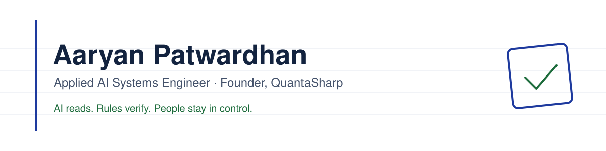

<picture>
  <source media="(prefers-color-scheme: dark)" srcset="assets/banner-dark.svg">
  
</picture>

  
  
  

## 👋 About me

I build **applied AI systems that take repetitive work off people's plates** — and I make them honest about what they don't know.

- 🧠 **My approach:** the AI reads, deterministic rules verify, and every doubt is shown to a person before anything is trusted.
- 🏢 **Founder of QuantaSharp**, an applied AI studio building systems that run in the cloud or fully on a client's own servers.
- 💼 **Open to** full-time roles in applied AI, backend and platform engineering.

## 🚀 Featured work

<table>
<tr>
<td width="50%" valign="top">

### 🧾 InvoiceAI
Reads Indian GST invoices — PDFs, scans and phone photos — and checks the AI's work.

`Python` `FastAPI` `Ollama` `Docker`

- Verification layer on local LLMs: GSTIN check-digit validation and OCR repair, totals and CGST/SGST cross-checks, seller/buyer correction from the document text
- Every doubtful field is flagged for review
- Automated tests with an accuracy gate in CI
- Dashboard built for non-technical and older users; works fully offline
- Private install package for on-premises clients

**Building next:** review screen, Tally & Zoho Books export, cloud deployment, accuracy on real-world invoices

🔒 Private commercial product — demo on request

</td>
<td width="50%" valign="top">

### 🛡️ [Hyron AI](https://github.com/Aaryan-Patwardhan/fusion2026)
Software supply-chain risk — FUSION 2026 hackathon (CSB-03).

`Python` `FastAPI` `React` `NetworkX`

- Maps vulnerable npm dependencies across projects
- Ranks real-world risk with OSV, FIRST EPSS and CISA KEV using a transparent scoring formula
- Proposes semver-safe upgrade plans

**Building next:** GitHub Action that comments new risks on pull requests; pnpm, Yarn and Python support

</td>
</tr>
<tr>
<td width="50%" valign="top">

### 📡 [Aura](https://github.com/Aaryan-Patwardhan/aura)
Passive attendance from campus Wi-Fi events.

`FastAPI` `Redis Streams` `PostgreSQL` `React` `Docker`

- Event-driven pipeline: RADIUS accounting → FastAPI → Redis Streams consumer → PostgreSQL
- Isolation Forest anomaly score for each session

**Building next:** FreeRADIUS bridge for real campus controllers, faculty/admin roles, impossible-travel detection

</td>
<td width="50%" valign="top">

### 📚 CramIQ
Exam-preparation platform for SPPU engineering students.

`FastAPI` `PostgreSQL` `Next.js` `Gemini`

- Study planner, study vault, progress streaks and an admin panel
- Deployed on Vercel with a DigitalOcean backend

**Building next:** production hardening and usage analytics before the next exam season

🔒 Private

</td>
</tr>
</table>

## 🧰 Tech stack

  

<b>AI:</b> local LLMs with Ollama (Qwen) · Gemini · evaluation harnesses · scikit-learn

## 🌱 Right now

- 🧪 Taking **InvoiceAI** from tested product to its first client pilot
- ☁️ Learning cloud infrastructure, DevOps and MLOps by shipping them into real products — AWS, Terraform, observability, model evaluation

---

  Let's talk about automating the boring parts of your work —
  <a href="https://www.linkedin.com/in/aaryan-patwardhan">LinkedIn</a> ·
  <a href="mailto:patwardhanaaryan@gmail.com">patwardhanaaryan@gmail.com</a>

